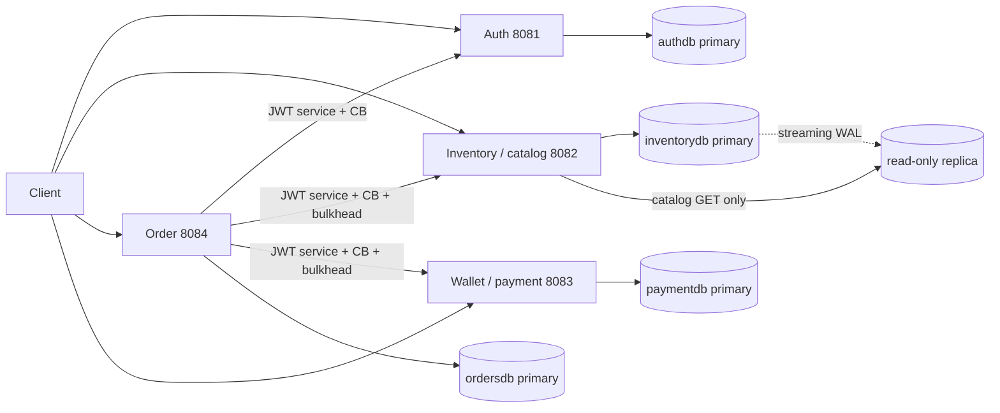
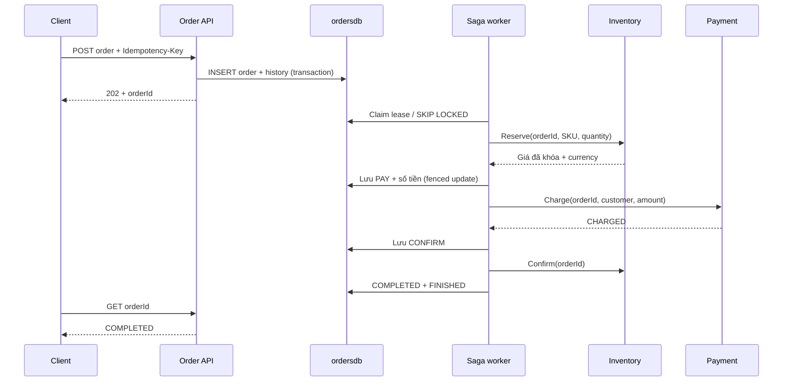

# Kiến trúc và tính đúng đắn

## Bounded contexts và dependency



Identity context quản lý Account/ServiceClient và token. Inventory context quản lý Product/Reservation. Ordering context quản lý Order/SagaJob và tiến trình mua. Payment context quản lý Payment/Money, ví và ledger. Bốn database/owner riêng nằm trên một PostgreSQL cluster phát triển; replication vật lý sao chép cả cluster. Không có foreign key, join hay transaction xuyên database/service.

`platform-common` chỉ chứa security resource-server, xử lý lỗi HTTP và công cụ demo. Nó không chứa entity sản phẩm, đơn hay thanh toán. Contract liên service là JSON, được mỗi adapter diễn giải sang port của context mình.

```text
service/src/main/java/vn/flashsale/<context>/
  domain/                 aggregate, value object, invariant, failure, state
  application/            use cases, orchestration
    port/                 interface cần từ database/remote service
  adapter/ hoặc infrastructure/
    web/                  REST DTO, validation, principal, lỗi HTTP
    persistence/ hoặc jdbc/ SQL repository, transaction
    http/                 outbound HTTP, token, Circuit Breaker
    worker/               scheduler, virtual thread, admission
  config/ hoặc configuration/  Spring bean wiring
```

Tên folder `adapter`/`infrastructure` có thể khác giữa context; chiều dependency vẫn hướng vào trong. Domain/application không phụ thuộc Spring, HTTP status, JDBC, adapter hoặc entity của service khác. Spring wiring và transaction nằm ở lớp ngoài. ArchUnit kiểm tra quy tắc này; Lombok dùng cho constructor/getter để tránh mã lặp, Java record cho dữ liệu bất biến.

## Saga orchestration lưu bền



Mỗi worker chỉ thực hiện **một bước** rồi persist bước tiếp theo; không giữ transaction DB trong lúc gọi HTTP. `orders` đồng thời là state machine và durable work queue. Đây là Saga với delivery **at least once**, không phải Event Sourcing hoặc Kafka outbox. `order_history` là audit lịch sử; không dùng nó để rebuild aggregate.

| Step | Hiệu ứng | Bước tiếp |
|---|---|---|
| RESERVE | Giữ hàng bằng orderId; nhận giá server | PAY |
| PAY | Debit ví bằng orderId và payload cố định | CONFIRM |
| CONFIRM | Giữ hàng thành CONFIRMED | FINISHED/COMPLETED |
| VOID_PAYMENT | Refund nếu đã debit; ghi tombstone nếu chưa charge | RELEASE |
| RELEASE | Trả hàng nếu đang RESERVED/CONFIRMED; ghi tombstone | FINISHED/REJECTED |

Hết hàng, hết cửa sổ sale, thiếu tiền hoặc payload conflict là lỗi nghiệp vụ: không retry forward, chuyển compensation. Lỗi timeout/503/429/network/OPEN circuit/bulkhead được lưu `next_attempt`, retry với exponential backoff 500 ms đến 30 giây và jitter 50..100%. Mỗi bước forward tối đa 8 lần, deadline toàn đơn 120 giây từ lúc nhận đơn. Compensation không bị giới hạn 8 lần hoặc deadline này; không được gắn REJECTED trước khi refund và release được xác nhận.

## Concurrency, restart và lease fencing

Worker dùng `Executors.newVirtualThreadPerTaskExecutor()` và semaphore mặc định 16. Scheduler poll 200 ms, lấy một hàng `FOR UPDATE SKIP LOCKED`, ghi `lease_token` ngẫu nhiên và `lease_until=now()+30s`, rồi commit trước khi gọi downstream. Hai replica order-service có thể xử lý nhiều đơn, tránh cùng claim một đơn còn lease.

Nếu tiến trình chết, lease hết hạn và instance khác claim lại. Nếu worker cũ sống lại sau khi hết lease, cập nhật chỉ thành công khi **token, step và lease chưa hết hạn** khớp. Worker cũ vẫn có thể đã gọi API; idempotency/tombstone tại downstream làm các tác động lặp an toàn. Không giả định timeout đã hủy được tác vụ bên kia.

Admission lưu đơn được giới hạn 1.000 đơn chưa kết thúc. Advisory transaction lock ngắn đảm bảo các instance cùng kiểm tra backlog, idempotency và insert nhất quán. Backlog đầy trả 429; duplicate key hợp lệ vẫn trả đơn cũ. Admission lock là điểm tuần tự có chủ đích của demo; ở quy mô lớn cần đo throughput, partition queue/admission thay vì tăng concurrency vô hạn.

## Invariant tồn kho

Thay vì đọc stock rồi trừ trong Java, inventory dùng một lệnh:

```sql
UPDATE products SET available_stock = available_stock - :quantity
WHERE id = :productId AND available_stock >= :quantity
  AND sale_starts_at <= statement_timestamp()
  AND sale_ends_at > statement_timestamp()
RETURNING *;
```

Predicate và decrement là nguyên tử trên primary. `CHECK available_stock>=0` tăng bảo vệ ở storage. Reservation unique theo orderId; insert placeholder `ON CONFLICT DO NOTHING`, sau đó `SELECT ... FOR UPDATE` để serialize retry và compensation. Payload product/quantity phải giống lần đầu. Giá trả về từ chính update được lưu vào reservation; retry vẫn giữ giá đó.

Reserve thành công giảm available stock một lần. Confirm không trừ lần thứ hai. Release khôi phục một lần nếu trạng thái còn giữ hàng; sau đó chuyển CANCELLED. Nếu release đến trước reserve, CANCELLED tombstone ngăn request reserve đến muộn. Release sau confirm cũng khôi phục được khi Saga đang hoàn tác kết quả HTTP confirm không chắc chắn.

Cửa sổ sale được xét tại thời điểm SQL statement bắt đầu bằng đồng hồ primary. Sale kết thúc sau khi đã reserve không vô hiệu hóa retry/confirm của reservation hợp lệ. Không dùng TTL tự release độc lập với Saga vì có thể nhả hàng trong lúc thanh toán thành công nhưng response bị mất. Khi Order bị ngừng lâu, hàng giữ lại cho đến khi Saga khôi phục; cần quan sát và phục hồi coordinator.

## Invariant thanh toán

Charge unique theo orderId và kiểm tra cùng customer/amount/currency. Transaction khóa payment row, debit có điều kiện `balance>=amount`, append DEBIT ledger unique `(order_id,event_type)`, ghi CHARGED rồi commit. Hai đơn khác nhau cùng ví không làm số dư âm vì predicate debit nguyên tử và CHECK balance>=0.

Void khóa cùng payment row. Nếu CHARGED thì refund, append REFUND và ghi VOIDED trong một transaction. Retry VOIDED không refund lại. Void trước charge ghi tombstone; late charge bị từ chối. Nếu request charge xử lý xong nhưng timeout, retry trả kết quả cũ; nếu Saga đã chuyển compensation thì void hoàn tiền đúng một lần. Các hàng tombstone và idempotency được giữ lại, không xóa theo TTL tùy tiện khi còn request/retry có thể đến muộn.

Sau khi mọi Saga kết thúc và không có tác nhân thay đổi dữ liệu: đơn COMPLETED có payment CHARGED và reservation CONFIRMED; đơn REJECTED có payment VOIDED và reservation CANCELLED; tổng tồn cộng số lượng RESERVED/CONFIRMED bằng seed; balance bằng seed trừ DEBIT cộng REFUND. Trong khi Saga đang chạy, các context có thể ở trạng thái trung gian; đây là eventual consistency có compensation, không phải transaction ACID toàn hệ thống.

## Security và resilience

Customer JWT có scope shop, admin JWT thêm admin, machine JWT chỉ internal. Client không được gọi mutation nội bộ dù biết port. Order/wallet/payment GET áp dụng quyền sở hữu. Resource services chỉ giữ public key JWKS, không có khả năng tự ký token. Issuer/audience/exp/nbf/signature đều được validate. Key signing được lưu volume để restart auth không làm mất hiệu lực token.

Outbound auth có Circuit Breaker và token cache; inventory/payment mỗi service có Circuit Breaker riêng và bulkhead 8. Network connect timeout 1 giây, HTTP request/read timeout 2 giây, driver SQL socket timeout 5 giây, DB pool hữu hạn và lock/statement timeout. Không gắn HTTP Retry nhiều lớp: Saga sở hữu retry bền vững để tránh nhân số lần gọi.

Circuit Breaker không giới hạn concurrency; bulkhead mới thực hiện admission cho lời gọi. Business rejection được ignore khỏi failure statistics, nhưng slow-call và 5xx vẫn có thể mở circuit. Không tạo fallback trả thành công giả cho giữ hàng/thanh toán.
