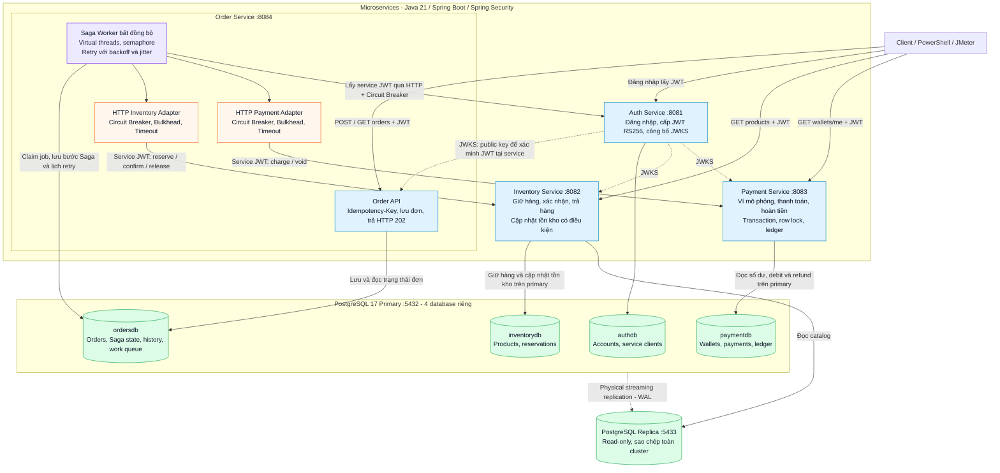

# Biểu đồ hệ thống Flash Sale

## Kiến trúc tổng thể



Các service tự xác minh JWT bằng public key JWKS; không gọi Auth cho mọi request. Order gọi Auth để lấy service token và cache token đó. Work queue nằm trong PostgreSQL, worker poll database; hệ thống hiện tại không dùng message broker.

Các cổng trên là cổng host của stack mặc định. Stack batch dùng 18081–18084 cho bốn service và 15432/15433 cho primary/replica.

## Luồng đặt hàng và Saga

```mermaid
sequenceDiagram
    autonumber
    actor C as Client
    participant O as Order API
    participant D as ordersdb Primary
    participant W as Saga Worker
    participant I as Inventory Service
    participant P as Payment Service

    C->>O: POST /api/orders + JWT + Idempotency-Key
    O->>D: Transaction: lưu đơn, bước RESERVE và history
    D-->>O: Commit thành công
    O-->>C: HTTP 202 + orderId
    Note over C,O: 202 xác nhận đã lưu đơn; chưa xác nhận thanh toán
    W->>D: Claim job bằng lease và SKIP LOCKED
    Note over W,D: Mỗi bước được lưu bền; lần xử lý sau claim lại job
    Note over W,P: HTTP có service JWT, Circuit Breaker, Bulkhead và Timeout
    W->>I: RESERVE: giữ hàng theo orderId
    I-->>W: Kết quả giữ hàng và giá từ server
    alt Giữ hàng thành công
        W->>D: Lưu bước PAY và số tiền
        W->>P: PAY: trừ ví theo orderId
        P-->>W: Kết quả thanh toán
        alt Thanh toán thành công
            W->>D: Lưu bước CONFIRM
            W->>I: CONFIRM: xác nhận reservation
            I-->>W: CONFIRMED
            W->>D: Lưu COMPLETED + FINISHED
        else Thiếu tiền hoặc lỗi nghiệp vụ
            W->>D: Chuyển sang VOID_PAYMENT để bù trừ
        end
    else Hết hàng hoặc lỗi nghiệp vụ
        W->>D: Chuyển sang VOID_PAYMENT để bù trừ
    end

    opt Saga đã chuyển sang bù trừ
        W->>P: VOID_PAYMENT: hoàn tiền nếu đã trừ, ghi trạng thái hủy
        P-->>W: VOIDED
        W->>D: Lưu bước RELEASE
        W->>I: RELEASE: trả hàng nếu đã giữ, ghi trạng thái hủy
        I-->>W: CANCELLED
        W->>D: Lưu REJECTED + FINISHED
    end

    C->>O: GET /api/orders/{orderId}
    O->>D: Đọc trạng thái
    D-->>O: Trạng thái đơn
    O-->>C: COMPLETED hoặc REJECTED khi Saga kết thúc
```

Biểu đồ sequence minh họa các nhánh nghiệp vụ khi lời gọi nhận được kết quả. Timeout, lỗi mạng, 503, Circuit Breaker OPEN hoặc Bulkhead đầy được lưu lịch retry với backoff và jitter. Nếu lỗi tạm thời ở bước forward vượt giới hạn retry hoặc deadline, Saga chuyển sang bù trừ. Bù trừ tiếp tục retry đến khi xác nhận hoàn tiền và trả hàng; chưa hoàn tất thì chưa đánh dấu REJECTED. Idempotency theo orderId và bản ghi hủy ngăn request đến muộn gây trừ tiền hoặc giữ hàng trở lại.

Mỗi service áp dụng Clean Architecture và DDD: domain ở trong, application/use cases phụ thuộc port, adapter web/JDBC/HTTP/worker ở ngoài. Pattern phối hợp giao dịch là Saga orchestration; order history phục vụ audit, không phải Event Sourcing.